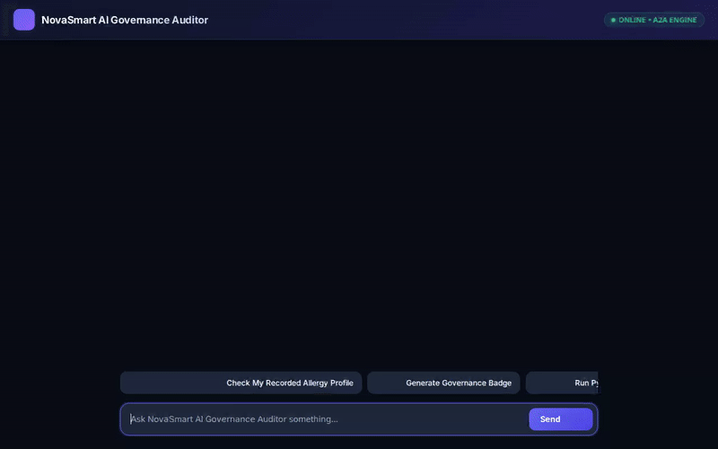

# NovaSmart AI Governance Auditor



**NovaSmart AI Governance Auditor** is an enterprise AI governance and security platform agent built on Google Cloud ADK (Agent Development Kit), Google GenAI, and Vertex AI. It helps AI Platform & Security leaders discover unsanctioned shadow agents, audit over-privileged service account identities, search package vulnerabilities, generate multimodal security badges and videos, execute sandboxed Python code, and store persistent security policies in a Firestore-backed Memory Bank.

---

## Implemented Capabilities & Architecture

Based on the implemented codebase in `app/` and `agents-cli-manifest.yaml`, the agent provides the following active tools and services:

### 1. 🛡️ AI Agent Estate Discovery & Shadow Agent Audit
- **Vertex AI Reasoning Engine Integration**: Discovers active reasoning engines and agent deployments across Google Cloud regions (`us-central1`, `us-east1`).
- **Identity & IAM Risk Analysis**: Identifies shadow agents operating on over-privileged default compute service accounts.
- **Firestore Audit Logging**: Queries persistent Firestore collections (`audit_logs`) to track agent deployment history and security events.

### 2. 🧠 Memory Bank & Preference Persistence (`google.adk.memory`)
- **Firestore Memory Store**: Saves and retrieves persistent memories (such as security compliance preferences, retention policies, and user profiles) to/from Firestore (`memories` collection).
- **Automated Memory Preloading**: Preloads relevant user memories into the context before processing security queries.

### 3. 🎨 Multimodal Media Generation (Imagen 3 & Gemini Omni)
- **Imagen 3 Badge Generation (`imagen-3.0-generate-002`)**: Generates custom AI security governance badges, saves them as ADK artifacts, and uploads them to Google Cloud Storage.
- **Gemini Omni Video Generation (`gemini-omni-flash-preview`)**: Generates short governance videos using Vertex AI Interactions API in location `global`, saves ADK artifacts, and uploads MP4 video bytes to Google Cloud Storage.
- **Public Cloud Storage (GCS) Integration**: Automatically uploads generated media to a public GCS bucket (`ai-governance-auditor-media-qwiklabs-gcp-03-aee88193e5fb`) and returns public HTTPS URLs for A2UI rendering.

### 4. 🔍 Vulnerability & Location Security Tools
- **CVE Package Vulnerability Search**: Queries NIST NVD and PyPI APIs to scan software dependencies for known CVE vulnerabilities.
- **Google Maps API**: Provides geocoding and nearby security office lookup using Google Maps Platform APIs.

### 5. 🐍 Sandboxed Python Execution & A2UI Rendering
- **Pyppeteer Python Sandbox**: Executes Python scripts safely inside a sandboxed Chromium environment.
- **A2UI Schema Manager (`google.adk.a2ui`)**: Formats agent outputs into structured A2UI UI payloads (`Card`, `Column`, `Row`, `Text`, `Image`) for web client rendering.

---

## Planned / Future Features

The following features were outlined in initial design concepts but are **planned, not yet implemented**:
- Automated real-time IAM role auto-remediation (planned, not yet implemented)
- Multi-cloud AWS/Azure agent discovery (planned, not yet implemented)

---

## Local Setup & Running Instructions

### Prerequisites
- Python 3.10+
- `uv` package manager (or `pip`)
- Google Cloud SDK (`gcloud`) authenticated to your GCP project with Firestore and Cloud Storage enabled.

### 1. Install Dependencies
```bash
uv pip install -r requirements.txt
```

### 2. Set Environment Variables
```bash
export GOOGLE_CLOUD_PROJECT="<your-gcp-project-id>"
export GOOGLE_CLOUD_LOCATION="us-central1"
export GOOGLE_GENAI_USE_VERTEXAI="true"
export GOOGLE_MAPS_API_KEY="<your-google-maps-api-key>"
export AGENT_ENGINE_RESOURCE_NAME="<your-reasoning-engine-resource-name>"
export AGENT_DIRECTORY="app"
```

### 3. Run the Frontend Locally
Navigate to the `frontend/` directory and run the FastAPI server:
```bash
cd frontend
python main.py
```
*The local chat interface will start serving on port 8080.*

---

## Repository Structure

```
.
├── app/
│   ├── agent.py                 # Core ADK agent, tools, instruction, Memory Bank & A2UI configuration
│   └── __init__.py
├── frontend/
│   ├── main.py                  # FastAPI proxy server connecting web UI to Agent Engine / ADK
│   └── static/
│       ├── index.html           # A2UI-compatible dark-mode chat UI
│       └── ...
├── agents-cli-manifest.yaml     # Agent deployment manifest and runtime environment config
├── demo.gif                     # Animated screen recording of live agent interactions
└── README.md                    # Project documentation
```
